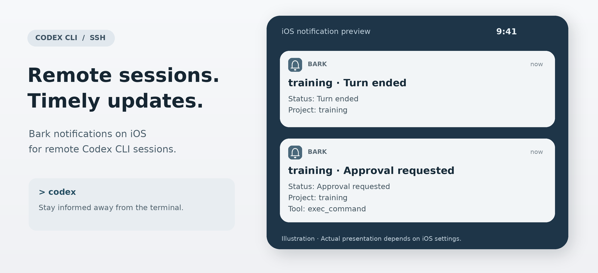

# BarkNotify-Plugin

BarkNotify-Plugin brings remote Codex CLI session alerts to iOS. Designed primarily for servers and clusters accessed over SSH, it sends a notification when a turn ends or approval is requested, so you can stay informed away from the terminal.

[简体中文](README.zh-CN.md) · [Command reference](docs/usage.md)



The receiver is the [official Bark iOS app](https://github.com/Finb/Bark). Android is outside the current support scope. English notifications are the default; Chinese is available.

The [Codex desktop app](https://developers.openai.com/codex/app/settings/#notifications) already provides turn-completion notifications. This plugin focuses on delivering remote CLI session alerts to mobile devices.

## Install

On the Codex host, use macOS or Linux with Git, Python 3.11+, curl, and Codex plugin management available. The host must be able to reach your Bark server.

### 1. Configure the mobile app

1. Install [Bark from the App Store](https://apps.apple.com/app/bark-custom-notifications/id1403753865) and open it.
2. Allow notifications. If you previously denied them, open **iOS Settings → Notifications → Bark → Allow Notifications**, then return to Bark.
3. Keep the default server, `api.day.app`. Wait for the device address to appear, then open the menu beside **Copy** and choose **Copy Address and Key**. Older versions may show a test URL instead.

### 2. Install in Codex

Run on the host where you use Codex:

```bash
codex plugin marketplace add https://github.com/Jinghaoleven/BarkNotify-Plugin.git
codex plugin add barknotify@barknotify-plugin
```

Provider launchers sharing the same `CODEX_HOME` need only one installation.

### 3. Set up notifications

Start a new Codex session and send:

> Set up BarkNotify-Plugin and guide me through entering my Bark URL privately in a terminal.

Codex will prepare the plugin and give you a setup command. Run it in a **separate terminal on the same host**, then paste the address copied from Bark at the hidden input prompt. For SSH or containers, use a terminal in that same environment. **Do not send your address or key in chat.** Paste the address, rather than a curl command.

For Chinese notifications, add “Use Chinese notifications” to your request. If you prefer to configure it yourself, follow [manual setup](docs/usage.md#manual-setup-from-the-installed-plugin).

### 4. Verify notifications

1. Confirm **BarkNotify-Plugin · Test** appears on your iOS device.
2. Restart Codex and review and trust Bark in `/hooks`.
3. Finish a short turn and confirm its automatic notification arrives.

Bark does not need to stay open afterward.

## Use

Ask Codex to check notification status, send a test, change the language, or pause notifications. You can also disable Bark in `/plugins`.

By default, you receive notifications when a turn ends or approval is requested. A turn may end while Codex waits for your reply; the notification does not mean the whole task is finished. [Commands and notification options](docs/usage.md#preferences) are available for manual use.

## Update or uninstall

To update:

```bash
codex plugin marketplace upgrade barknotify-plugin
codex plugin add barknotify@barknotify-plugin
```

Then ask Codex to finish updating BarkNotify-Plugin. Restart Codex and review `/hooks` again. Your saved device address and preferences are kept.

To uninstall:

```bash
python3 "${CODEX_HOME:-$HOME/.codex}/bark/runtime/scripts/barknotify.py" uninstall
```

Saved settings are kept for reinstallation. See [manual removal](docs/usage.md#removal) if you already removed the plugin through `/plugins`.

## Troubleshooting

| Problem | What to do |
| --- | --- |
| Bark has no device address | Allow notifications, return to Bark, and wait while connected to the network |
| Setup needs a key | Run setup and enter the address from Bark |
| Test was accepted but no mobile notification appears | Check Bark notification permission, Focus settings, and that you copied the receiving device's address |
| Manual test works but automatic notifications do not | Enable Bark in `/plugins`, review `/hooks`, and restart Codex |
| Proxy reports CONNECT 403 | Ask your network administrator to allow your Bark server, or use a working proxy; keep your key. See [network checks](docs/usage.md#network-and-proxy-troubleshooting) |

For a self-hosted Bark server, add and select it in the Bark App before copying the device address.

## Privacy

Automatic notifications can show the project or session name, status, and model/tool names. Conversation content is not sent. Use a session name suitable for your lock screen. The push address is stored privately on the Codex host; notifications go to your chosen Bark server. There is no analytics.

Licensed under [Apache-2.0](LICENSE). [Developer guide](docs/development.md).
