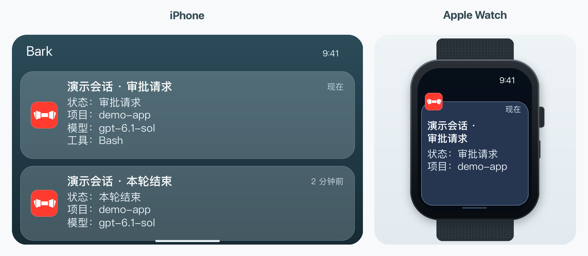

# BarkNotify-Plugin

通过 [Bark](https://github.com/Finb/Bark) 在 iPhone 上接收远程 Codex CLI 会话通知。默认通知“本轮结束”和“审批请求”，支持中文和英文。

[English](README.md) · [命令说明](docs/usage.md) · [网络扩展](extensions/reverse-socks/README.zh-CN.md)

<p align="center">
  
</p>

## 开始使用

Codex 所在主机需要 macOS 或 Linux、Codex 插件管理、Git、curl 和 **Python 3.11+**。

1. 在 iPhone 安装 [Bark](https://apps.apple.com/app/bark-custom-notifications/id1403753865)，打开并允许通知。保留默认服务器，设备地址出现后，选择 **复制 → 复制地址和 Key**。
2. 在运行 Codex 的主机安装：

   ```bash
   codex plugin marketplace add https://github.com/Jinghaoleven/BarkNotify-Plugin.git
   codex plugin add barknotify@barknotify-plugin
   ```

3. 打开 Codex 会话，发送：

   > 请配置 BarkNotify-Plugin，使用中文通知，并引导我在终端私密输入 Bark 地址。

   在**同一主机的另一个终端**运行 Codex 提供的配置命令，在隐藏输入提示处粘贴设备地址。**不要把地址或 key 发到聊天中。** 也可参照[手动配置](docs/usage.md#manual-setup)。
4. 确认手机收到 **BarkNotify-Plugin · Test**。在 `/hooks` 检查并信任 Bark。如果安装后没有看到 hooks，重新启动或恢复 Codex 再检查。结束一个简短回合，确认自动通知送达。

配置后无需保持 Bark 打开。配对的 Apple Watch 可在 Watch App 中开启 Bark 通知镜像。多个启动器共用 `CODEX_HOME` 时，只需安装一次。

## 日常使用

可以请 Codex 检查状态、修改语言、暂停或恢复通知、发送测试。修改偏好会保留当前暂停或开启状态，也可以在 `/plugins` 禁用插件。

“本轮结束”可能表示 Codex 正在等你回复，不代表整个任务成功完成。通知尽力送达；目前不支持 Android。

## 更新与卸载

```bash
codex plugin marketplace upgrade barknotify-plugin
codex plugin add barknotify@barknotify-plugin
```

然后请 Codex 完成插件更新，并检查 `/hooks`。当前会话仍使用旧 hooks 时，重新启动或恢复会话。保存的设备地址和偏好会保留。

卸载时请 Codex 卸载 BarkNotify-Plugin，或使用[卸载命令](docs/usage.md#removal)。保存的设置会保留，方便重新安装。

## 常见问题

| 问题 | 处理 |
| --- | --- |
| Bark 没有设备地址 | 允许通知，返回 Bark，联网等待 |
| 测试已被服务器接受，但手机未显示 | 检查 iOS 通知权限、专注模式和接收设备地址 |
| 手动测试正常，自动通知没有 | 检查 `/plugins`、暂停状态和 `/hooks`；hooks 缺失或过期时重新加载会话 |
| 主机无法连接 Bark | 运行[网络检查](docs/usage.md#network)，保留 key；使用可用代理或[独立 SSH 隧道扩展](extensions/reverse-socks/README.zh-CN.md) |
| 更换手机或自建服务器 | 在 Bark 选择服务器，再用对应设备地址重新配置 |

## 隐私

自动通知包含会话或项目名称、状态，以及可选的模型和工具名称。不会发送提示词、回复、命令、完整路径或会话 ID。请使用适合锁屏展示的名称。凭据私密保存在 Codex 主机上，位于插件缓存之外；推送发送到你选择的 Bark 服务器，不收集分析数据。

[Apache-2.0](LICENSE) · [开发文档](docs/development.md) · [安全说明](SECURITY.md)
