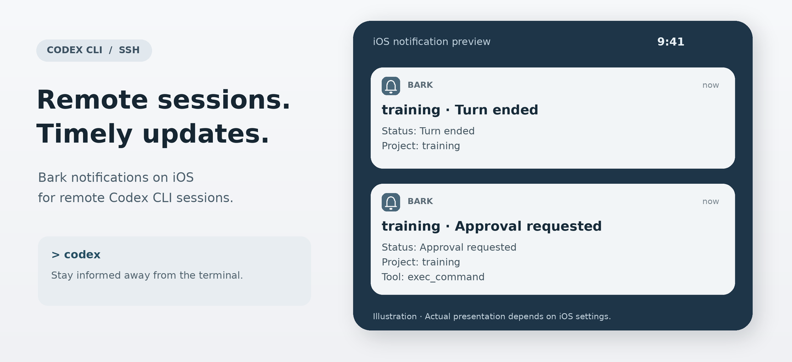

# BarkNotify-Plugin

BarkNotify-Plugin 为远程 Codex CLI 会话提供 iOS 移动端通知，主要面向通过 SSH 使用服务器或集群的场景。会话结束一轮处理或请求审批时，可在移动端接收提醒，无需持续关注远程终端。

[English](README.md) · [命令参考](docs/usage.md)



接收端为 [Bark 官方 iOS 客户端](https://github.com/Finb/Bark)，Android 不在当前支持范围。通知默认英文，可切换为中文。

[Codex 桌面应用](https://developers.openai.com/codex/app/settings/#notifications)已提供回合完成通知；本插件侧重将远程 CLI 会话提醒发送到移动端。

## 安装

Codex 主机支持 macOS 或 Linux，需安装 Git、Python 3.11+、curl，并具备 Codex 插件管理功能。主机需能访问 Bark 服务器。

### 1. 配置移动端

1. 从 [App Store 安装 Bark](https://apps.apple.com/app/bark-custom-notifications/id1403753865)，并打开 App。
2. 允许通知。如果此前拒绝过，进入 **iOS 设置 → 通知 → Bark → 允许通知**，再回到 Bark。
3. 使用默认服务器 `api.day.app`。等设备地址出现后，打开“**复制**”旁的菜单，选择“**复制地址和Key**”；旧版本可复制页面显示的测试推送 URL。

### 2. 在 Codex 中安装

在运行 Codex 的主机上执行：

```bash
codex plugin marketplace add https://github.com/Jinghaoleven/BarkNotify-Plugin.git
codex plugin add barknotify@barknotify-plugin
```

共享同一个 `CODEX_HOME` 的 provider 启动器只需安装一次。

### 3. 配置通知

启动新的 Codex 会话，发送：

> 请配置 BarkNotify-Plugin，引导我在终端私密输入 Bark URL。

Codex 会完成接入并给出配置命令。在**同一主机另开终端**运行它，将 Bark 复制的地址粘贴到隐藏输入提示中。使用 SSH 或容器时，在同一个环境中操作。**不要把地址或 key 发到聊天里。** 粘贴设备地址，不要粘贴整段 curl 命令。

需要中文通知时，在请求中加上“通知使用中文”。也可以按 [手动配置步骤](docs/usage.md#manual-setup-from-the-installed-plugin) 自行操作。

### 4. 验证通知

1. 确认移动端收到 **BarkNotify-Plugin · Test**。
2. 重启 Codex，在 `/hooks` 中审阅并信任 Bark。
3. 完成一个简短回合，确认自动通知送达。

设置完成后，Bark 无需一直开着。

## 使用

可以让 Codex 检查通知状态、发送测试、切换语言或暂停通知，也可以在 `/plugins` 中禁用 Bark。

默认通知为“本轮结束”和“审批请求”。Codex 等待你回复时也可能结束回合，因此通知不代表整个任务已完成。手动操作见 [命令和通知选项](docs/usage.md#preferences)。

## 更新或卸载

更新：

```bash
codex plugin marketplace upgrade barknotify-plugin
codex plugin add barknotify@barknotify-plugin
```

然后让 Codex 完成 BarkNotify-Plugin 的更新。重启 Codex，重新检查 `/hooks`。已保存的设备地址和偏好会保留。

卸载：

```bash
python3 "${CODEX_HOME:-$HOME/.codex}/bark/runtime/scripts/barknotify.py" uninstall
```

卸载保留设置，便于重装。如果已经在 `/plugins` 中移除插件，见 [手动清理](docs/usage.md#removal)。

## 排查问题

| 问题 | 操作 |
| --- | --- |
| Bark 没有设备地址 | 允许通知，回到 Bark，保持联网并等待 |
| 配置时提示缺少 key | 运行配置命令，输入 Bark 显示的地址 |
| 测试已被接受，移动端未显示通知 | 检查 Bark 通知权限、专注模式，以及是否复制了接收设备的地址 |
| 手动测试正常，自动通知不工作 | 在 `/plugins` 启用 Bark，在 `/hooks` 审阅，并重启 Codex |
| 代理提示 CONNECT 403 | 请网络管理员放行 Bark 服务器，或使用可用代理；保留现有 key。见 [网络检查](docs/usage.md#network-and-proxy-troubleshooting) |

使用自建 Bark 服务器时，先在 Bark App 中添加并选择它，再复制设备地址。

## 隐私

自动通知可能显示项目或会话名、状态及模型和工具名，不发送聊天内容。请使用适合锁屏展示的会话名。推送地址私密保存在 Codex 主机，通知发送到你选择的 Bark 服务器，无统计上报。

采用 [Apache-2.0](LICENSE) 许可证。[开发指南](docs/development.md)。
